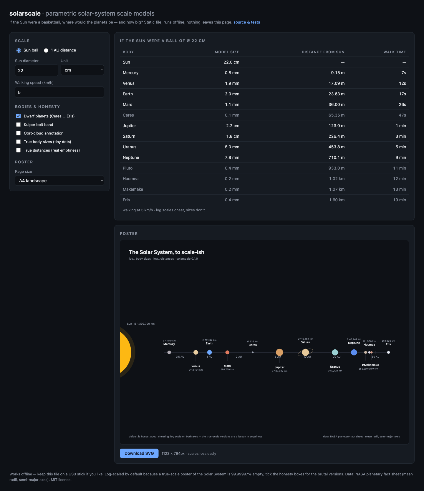

# solarscale

Parametric solar-system scale models, in one HTML file.

If the Sun were a basketball, the Earth would be a 2 mm pinhead 26 meters
away — and Pluto a 0.4 mm speck 2.1 km down the road. solarscale answers
that question for any anchor you like, then hands you a printable SVG
poster.

**It's one file.** `index.html` runs offline in any browser — copy it to
a USB stick, open it on a school computer, project it in class. No
install, no server, no account, nothing leaves the page. Or just use the
hosted copy: **https://p2plus.github.io/solarscale/**

## What it does

- **Walk model** — pick an anchor ("Sun is a Ø 22 cm ball" or "1 AU =
  100 m") and get every body's model size, model distance, and walking
  time. Dwarf planets and an Oort-cloud edge row on request.
- **Poster** — a live SVG preview (A4/A3/16:9) with the Sun bleeding off
  the left edge, planets on a labeled AU axis, Saturn's ring, Kuiper
  belt band, Oort annotation. **Download SVG** is the one output format,
  chosen on purpose: print it, cut it, edit it in Inkscape or
  Illustrator, embed it — SVG never rots.
- **Honesty toggles** — default is log/log, and the poster says so.
  `true body sizes` turns planets into what they really are (dots);
  `true distances` shows the real emptiness. Both are lessons worth
  teaching.

## Why one HTML file

The audience is teachers. School machines: no Python, no install rights,
sometimes no exe execution — but always a browser. A static file with
zero dependencies is the whole point, so the test suite enforces it: the
tests extract the marked core block out of `index.html` and fail if the
core ever touches the DOM or leaves the file.

## Numbers

Data is NASA's planetary fact sheet: mean radii and semi-major axes
(Sun 695,700 km; Earth 6,371 km / 1 AU; Eris out at 67.7 AU). The
basketball sanity check — Earth ≈ 107 Sun-diameters out — is a test.

## Honest limitations

- Default poster cheats with log scales on both axes (labeled on the
  poster itself). True-scale versions are one checkbox away.
- Mean radii: Saturn ignores its rings, Haumea is an ellipsoid averaged
  to something round.
- No moons in v1. The Moon at true scale sits 30 cm from your 2 mm
  Earth — worth a thought, not yet a feature.
- The Oort cloud is drawn as an annotation, not to scale, because at
  100,000 AU nothing on the page would be.

## Tests

    node --test     # 25 tests — core math, formats, poster structure

CI runs them on Node 20/22 across Linux, macOS, Windows.

## License

MIT.
